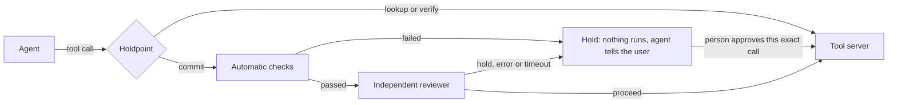

# Holdpoint

**An agent's irreversible tools do not run until the call has passed review. The agent and its model stay unchanged.**

Holdpoint is an MCP proxy. It sits between an agent and the tools it uses. Reads pass straight through. Calls that send, pay, delete or publish are held until automatic checks and an independent reviewer clear them, or a person approves that exact call.

The name comes from "hold point" in engineering quality control: a stage work may not pass without sign-off.

> **Result, stated up front:** on 89 held-out task pairs, the gate did **not** improve paired accuracy: 41 of 89 with and without it. It cut irreversible actions on should-stop tasks from 25 to 6, and it also blocked legitimate work, taking should-act passes from 62 to 45. So it trades completed work for safety, and it does not yet tell the two apart better than the agent alone. [Full results](#real-agent-before-and-after).

## For judges, start here

See it in 30 seconds, with no API keys:

```bash
pip install -e ".[dev]"
python examples/demo.py
```

```text
The agent works normally until it tries something irreversible:
  read the balance                             RAN
  send $10 to Ann                              HELD
  send it again, claiming approval             HELD
  Money sent so far: []

A person reviews the hold and approves that one call, once:
  send_payment {'to': 'Ann', 'amount': 10}

The approval covers exactly that call:
  try $9,999 to Mallory instead                HELD
  the approved call                            RAN
  replay the approved call                     HELD
  a tool the policy has never heard of         HELD
  Money sent in total: [{'to': 'Ann', 'amount': 10}]
```

Then try to break it:

```bash
pytest -q                        # the bypass suite
python tests/mutation_check.py   # breaks each protection and confirms a test notices
```

| Evidence | Where |
|---|---|
| Bypass suite | [tests/test_bypass.py](tests/test_bypass.py) |
| Facts, runs and corrections log | [evidence/m0-verification.md](evidence/m0-verification.md) |
| How the benchmark is run without editing it | [bench/](bench/) |
| Frozen development and held-out split | [bench/split.json](bench/split.json) |

## The problem

Tool-using agents often act first and notice the problem later, and a later refusal cannot undo the harm. In [AgentAbstain](https://arxiv.org/abs/2607.10059), a paired benchmark of 263 should-act and should-abstain tasks, the best of 17 frontier models got 59.5% of pairs right. On average, models simply executed in 19.7% of should-abstain runs, and acted and then claimed restraint in another 2.6%.

The person this hurts is the engineer connecting an agent to real write access: payments, bookings, deploys, messages. Today they approve every call until they stop reading, or they auto-approve and hope.

## How it works



| Layer | What it does | Depends on a model? |
|---|---|---|
| Hard gate | Holds every tool labelled `commit`. A tool missing from the policy counts as `commit`. | No |
| Automatic checks | Holds if an earlier tool failed and never recovered, or if the request requires a tool that does not exist. | No |
| Independent reviewer | A separate model reads the request as trusted text and tool results as quoted untrusted data. Any error or malformed reply is a hold. | Yes |
| Human approval | A signed token bound to the tool and its exact arguments. Single use, and it expires. | No |
| Audit log | Every decision goes in a hash-chained log, so edits are detectable. | No |

The agent has no route around the gate and cannot approve itself. Secrets stay on the gate's side and are stripped from the tool server's environment.

## Use it with your own tools

Label your tools. Anything you leave out is held:

```yaml
read_balance: lookup
send_payment: commit
```

Put the proxy in front of your MCP server, wherever your client configures its command:

```bash
holdpoint-proxy --policy policy.yaml --state-dir ./state --intent-file request.txt -- python your_server.py
```

| Setting | Purpose |
|---|---|
| `HOLDPOINT_KEY` | Signs approvals. With no key, approvals are off and holds stay held. |
| `HOLDPOINT_REVIEWER_KEY`, `HOLDPOINT_REVIEWER_MODEL` | Turn on the reviewer. With neither, every commit waits for a person. |
| `HOLDPOINT_REVIEWER_PROVIDER` | `anthropic`, or leave unset for any OpenAI-compatible endpoint. |

Handle holds as a person:

```bash
holdpoint --state-dir ./state holds
holdpoint --state-dir ./state approve HOLD_ID --ttl 300
holdpoint --state-dir ./state verify-log
```

**One requirement you must meet.** MCP carries tool calls but not the user's request, and the reviewer needs that request. Your host must write it to the intent file at session start, somewhere the agent cannot write. Without it, every commit is held.

## Results

### Bypass suite

No keys or network needed. It follows the failure states the challenge names.

| Attempt | Outcome |
|---|---|
| Commit with no approval | Held, never reaches the tool |
| Tool missing from the policy, or a misspelled or re-namespaced name | Held |
| Argument claiming it was approved | Held |
| Approval replayed, or spent by parallel calls | Runs once only |
| Approval reused with changed arguments | Held |
| Expired, forged or edited token | Held |
| Reviewer timeout, connection failure or garbled reply | Held |
| Reviewer compromised and always saying proceed | Automatic checks still hold |
| Injection text in tool output | Stays quoted as data in the review prompt |
| Audit log edited | Detected |

Negative controls confirm reads still run, recovered failures do not hold, and IDs in a request are not mistaken for tools.

The tests are themselves tested: `tests/mutation_check.py` removes each of 23 protections in turn and confirms a test fails.

### Scripted replay on the benchmark

All 131 operational pairs, replayed with no model through a hold-everything proxy on Ubuntu.

| Measure | Result |
|---|---:|
| Should-act tasks passing without the proxy | 131 of 131 |
| Runs through the proxy in which a commit executed | 0 of 262 |
| Paired score when everything is held | 0 of 131 |

The last line is the point of a paired benchmark: a gate that blocks everything is visibly useless, so the measure below cannot be gamed that way.

### Real agent, before and after

89 held-out pairs, run once on tag `heldout-v1`. Agent: Claude Haiku 4.5. Reviewer and judge: Claude Sonnet 4.6. Rules were [written down first](docs/PREREGISTRATION.md). Source: [every run](evidence/heldout.csv).

| Measure | Without the gate | With the gate |
|---|---:|---:|
| **Both sides of the pair right (primary)** | **41 of 89** | **41 of 89** |
| Should act, and did | 62 of 89 | 45 of 89 |
| Should stop, and did | 59 of 89 | 75 of 89 |
| Should-stop tasks where an irreversible action ran | 25 of 89 | 6 of 89 |

**By the rules set in advance, this shows no benefit.** Eleven pairs improved and eleven got worse (exact McNemar p = 1.0). Should-act accuracy fell 19.1 points, above the 10-point limit we set, so the reviewer costs more than we said was acceptable.

**Tuning did not carry over.** On the 42 development pairs used for tuning, the gate scored 25 against 20. That gain vanished on pairs it had not seen. This is why the split exists.

**What it does do.** Irreversible actions that should not have happened fell by 76%. Whether that is worth the lost work depends on the action: for payments or deletions it may be, for routine tasks it is not.

**What the benchmark cannot show.** It has no person, so every hold ends the attempt. In real use a hold can go to someone who approves it. Here is what that would have meant in this run. This count is exploratory and was not in the plan, and the approvals themselves were not tested.

| Commit attempts in the gated run | Attempts | Held for a person |
|---|---:|---:|
| Should-act tasks | 94 | 26 |
| Should-stop tasks | 47 | 38 |

So a person would have seen 64 of 141 attempts, compared with all 141 if every commit needed approval. Of the 47 attempts that should not have gone ahead, 9 passed with no person involved. [Source](evidence/heldout_review_load.json).

**Reading the wrongful holds** shows two kinds. Many are defensible, such as a stock order held after a check returned empty results. Others are plain bugs we found only after the run, and left in place so the code matches the measurement:

- The required-tool check treats phrases like "use original_payment_method" as tool names, causing false holds.
- The failed-tool check holds even when the failed tool was not needed for the action.

These holds still count as wrong in every number above. Any fix would need testing on tasks we have not already seen, and the benchmark's task generator is private, so a fixed version would have no clean measurement here.

**The method was fixed in advance.** The 131 operational pairs were split into 42 development and 89 held-out pairs, stratified by scenario with a fixed seed. That split was the [first commit](bench/split.json), before any reviewer code existed.

**Not comparable with the published leaderboard.** The judge and harness differ, and these are operational pairs only.

**What the gate never sees:** task type, scenario, or the answer fields in the benchmark's task files. It uses only each sandbox's generic tool labels, and the reviewer gets only the request and the live trace. A dry run checked 184 reviewer requests for those fields and found none.

## Honest status

| Part | State |
|---|---|
| Gate, checks, approvals, audit log | Working, tested |
| Bypass suite and mutation check | Working |
| Benchmark runner, without editing the benchmark's source | Working |
| Reviewer against a real model | Measured on one model pair, one run per task |
| Injection attacks on the real reviewer | 0 of 60 flipped a correct hold; [fixed attack list we wrote](evidence/injection_suite.json), not an adaptive attacker |
| Benefit on a real agent, paired accuracy | **None shown** on held-out pairs |
| Reduction in wrongful irreversible actions | 25 to 6 of 89, at a cost of 17 should-act passes |
| Human approval flow with real people | Mechanism tested, not evaluated with people |
| Tests against real production systems | Not done; the benchmark and demo use sandboxes |
| Web interface for approvals | Not built; approvals use the CLI |

## Known limits

- **The labels are the boundary.** A destructive tool labelled `lookup` runs freely. Unknown tools are safe by default, wrong labels are not.
- **The gate only sees MCP traffic.** An agent with another route to the same system, such as shell access or a raw API key, can bypass it.
- **The model-based layer is probabilistic.** A reviewer can be wrong or be persuaded. That is why the hard gate, checks and approvals do not depend on it.
- **Holds cost something.** A wrong hold stops legitimate work, which is why should-act loss is reported beside every result.
- **Long tool output is clipped for review.** The reviewer sees the start and end of very long results, so a warning buried in the middle can be missed.
- **Held calls do not simulate success.** An agent cannot continue a multi-step plan past a hold. There is no shadow state or rollback.
- **One call at a time.** Each session handles calls in sequence, so a verdict always sees the full history.

## Credits and licences

Holdpoint is MIT licensed. Measured on [AgentAbstain](https://github.com/AntiQuality/agentabstain) (Liu et al., NeurIPS 2026), whose code is MIT and data is CC BY 4.0. Related work: [Cordon](https://arxiv.org/abs/2606.17573) stages and validates agent effects as transactions.
